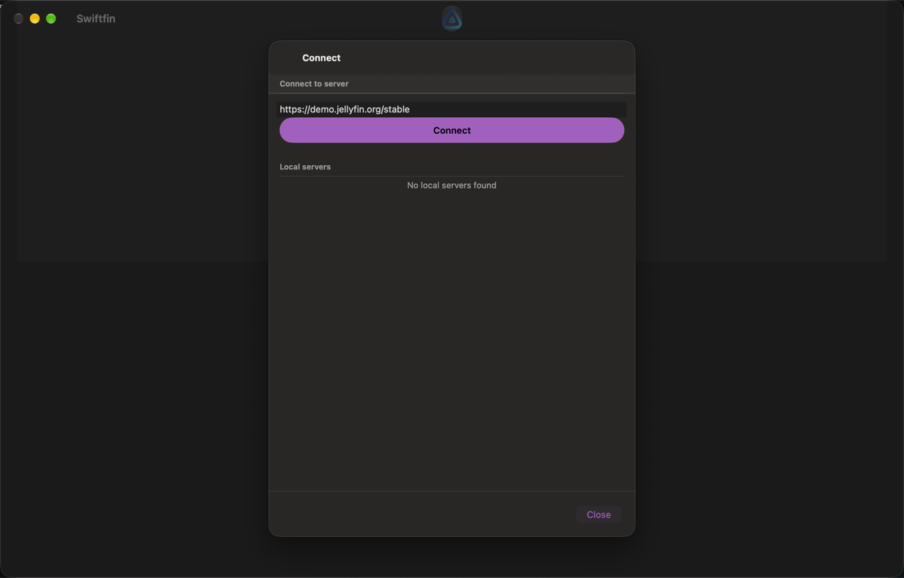
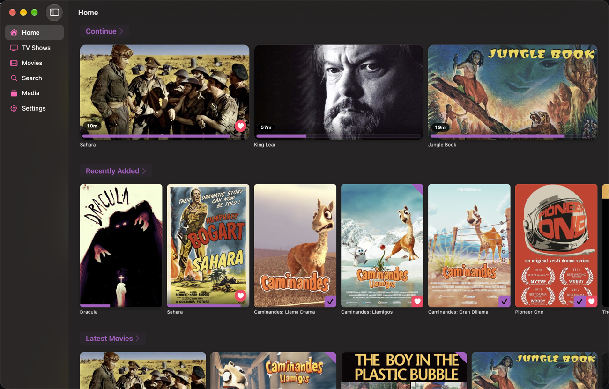
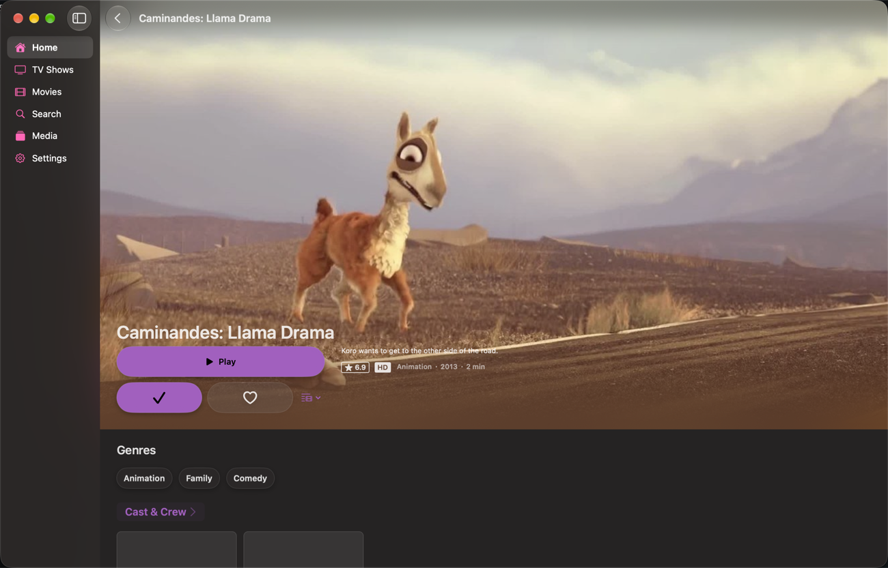
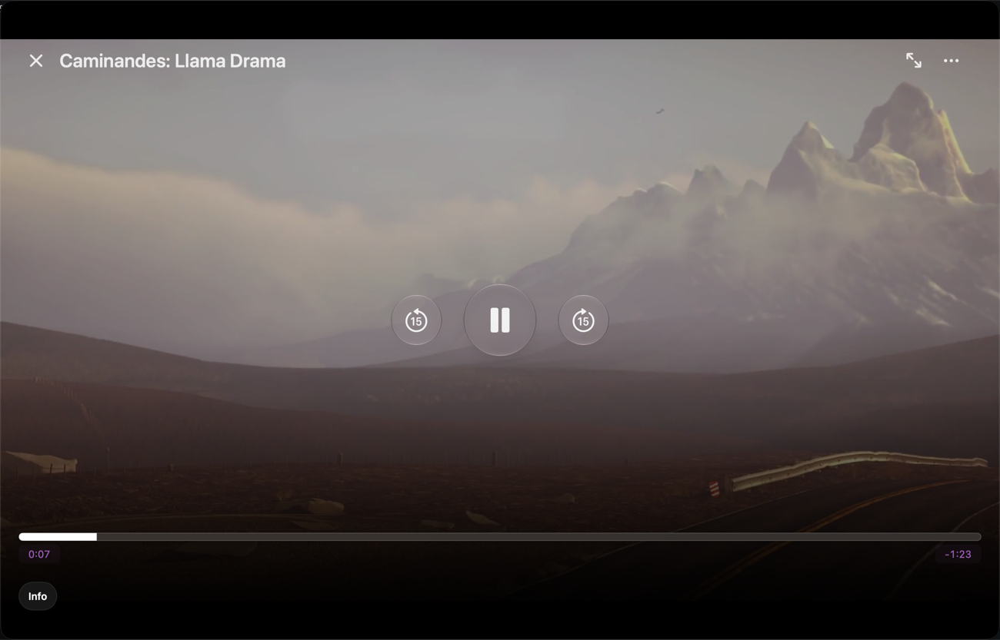
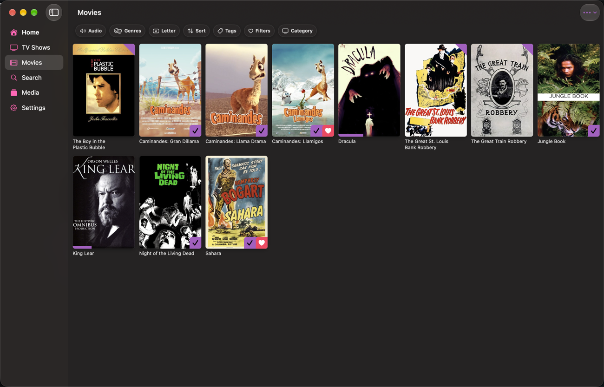
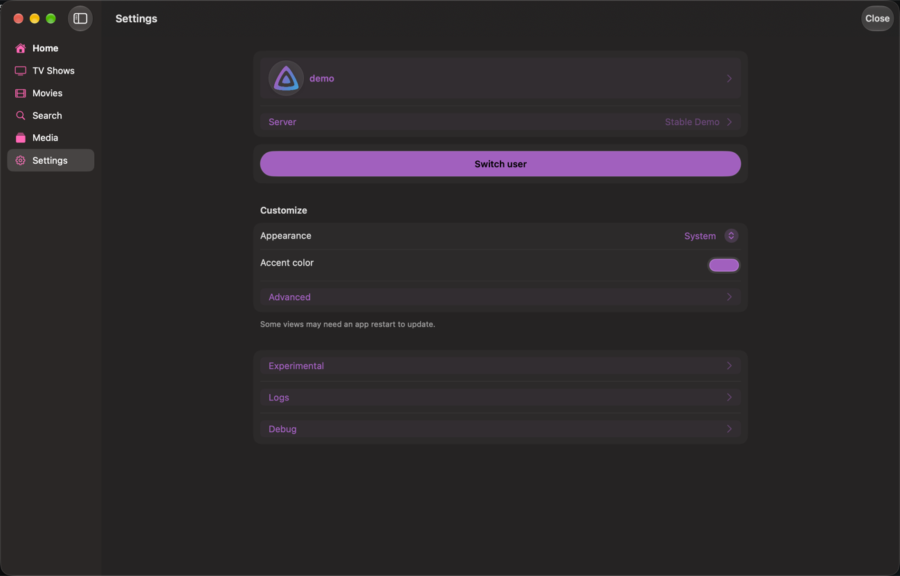

# Swiftfin for macOS: status

Branch `macos-port` on the fork, based on `origin/main` (db3ae5c9). Milestone 1 of the brief
(native macOS target that builds, signs in, browses and plays) works. Milestone 2 (offline
downloads) and milestone 3 (Mac polish) are not started.

## Build and run

    Tools/macOS/build.sh            # Debug; pass Release for an optimized build
    open build/Swiftfin.app

The script runs `xcodebuild -scheme "Swiftfin macOS"` with ad-hoc signing and copies the product
to `build/Swiftfin.app`. Requires Xcode 27 and macOS 26 or later.

## What works (verified by running the app against demo.jellyfin.org)

| | |
|---|---|
| Connect to a server, sign in |  |
| Home with poster rows |  |
| Item page |  |
| Playback (MPV), pause, seek, track/speed menu, fullscreen, close |  |
| Library grid with filters |  |
| Settings |  |

Relaunching while signed in restores the session.

The tvOS target still builds. The iOS target fails with two errors in
`VideoPlayer+LayoutView.swift` (`reservedRegions(kind:)`, an iOS 27.1 SDK API); that file's code
is unchanged from upstream, which needs a newer Xcode than 27.0, so this is not caused by the port.

## Not verified

Compiles but has not been exercised: TV shows and episode queues, search, the TV guide (a new
`NSCollectionView` implementation), the admin dashboard and item editor, the photo picker, the
AVPlayer backend, subtitles, the supplement panels in the player, Picture in Picture, multiple
windows, Quick Connect, and the Release configuration.

## Decisions

- **Merge, then redo conflicts by hand.** `ComicBit/feature/macos-port` was merged into a branch
  from main with all 84 conflicts resolved to main, because main had moved 254 commits. Most of
  the port's edits to existing views were later reset to main and only the macOS branches kept.
- **Upstream collection views and player.** `CollectionHStack`, `CollectionVGrid` and `MPVUI` now
  support macOS natively, so the port's scroll-view reimplementation was dropped.
- **Target generated by a script** (`Tools/macOS/add_macos_target.py`), so it can be re-created
  on top of a newer upstream project file. macOS-only sources live in `Swiftfin macOS/`.
- **Player.** The UIKit container is iOS/tvOS only; macOS has a SwiftUI/AppKit container that
  reuses the shared playback controls, with pointer and keyboard input (space, arrows, F, Esc).
  No fake Picture in Picture window.
- **Deployment target macOS 26**, because main uses APIs that are only available there.
- **Own bundle identifier** (`org.jellyfin.swiftfin.macos-fork`), so the build does not share a
  sandbox container with an installed iOS-on-Mac Swiftfin.
- **Credentials.** An ad-hoc signed build cannot use the data protection keychain. `MacKeychain`
  uses it when it is available (team-signed builds) and otherwise the login keychain, which asks
  for the login password once after every rebuild. Launching with `-storesCredentialsInFile YES`
  keeps tokens in an unencrypted file in the app's container instead; that exists only so
  automated test runs are not blocked by the prompt.

## Known gaps on macOS

- Player: black band where the title bar would be in windowed mode; volume only on the up/down
  keys; no gesture settings, Chromecast or AirPlay button.
- MPV Picture in Picture goes through MPVUI, whose macOS path uses a private system API.
- About ten admin and item-editor lists only offer delete through swipe actions.
- Forms and sheets use iOS layouts and guessed sheet sizes; no menu bar commands yet.
- App icon selection, Spotlight indexing, haptics and Wi-Fi/location options are absent.
- Cmd-H is treated as "entered background", as on iOS.

## Next steps

1. Exercise the unverified areas above and fix what breaks.
2. Milestone 2: download manager with Codable metadata in Application Support (not CoreStore).
3. Milestone 3: menu bar commands, window restoration.
